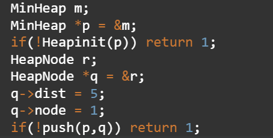
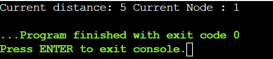

# IMPLEMENTING A MIN-HEAP IN PURE C 
This is a simple mini-project  where I have implemented MIN-HEAP in pure C. This project can provide useful guidance and can
illustrate low level handling of so many STL we use day-to-day.

## Features
It is educational purpose coding project for implementing MinHeap.
-Implemented in pure C
-Low-Level 

## Requirements
Usually doumenatation having such implementation can be cumbersome and daunting for a beginner. Thus this project serves as good
starting point for learning about the low level implementation logic of frequent data structures. A good programmer can always 
gain useful insights about the system using such projects and give them finer control over the program and can some times help
in optimization a code or debugging it.




## INSTALLATION
 ```bash
git clone <https://github.com/nikhilswayam16-cmyk/MinHeap>
git cd MinHeap

